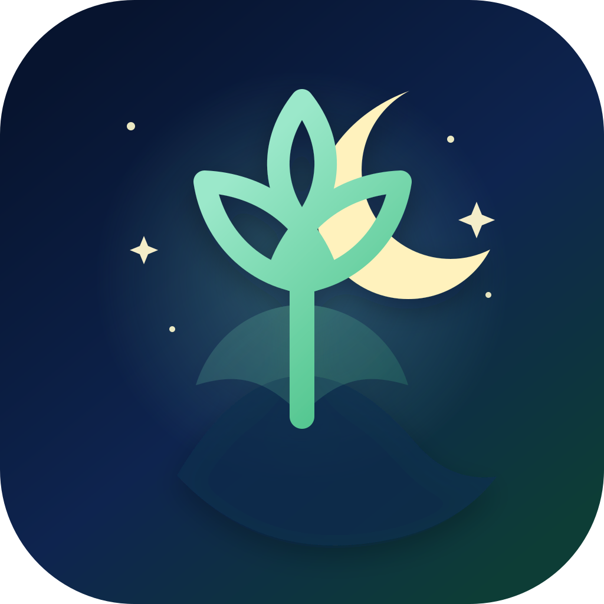
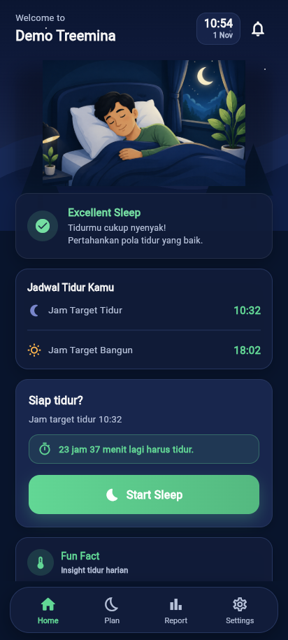
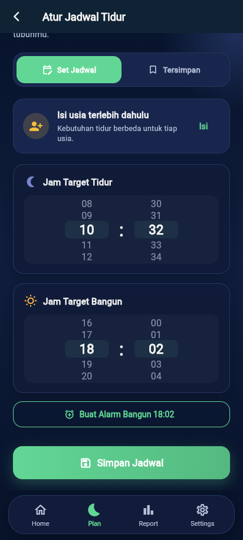
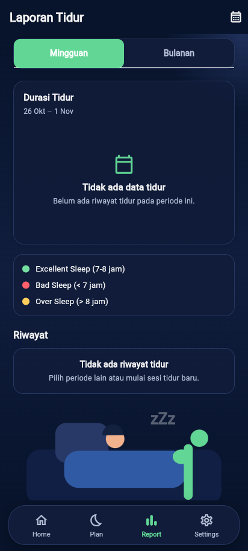
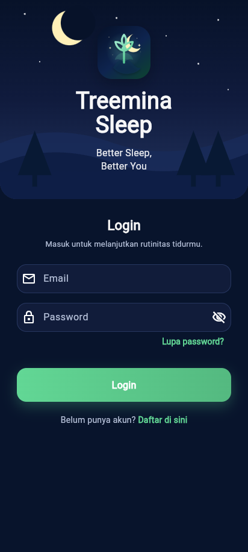
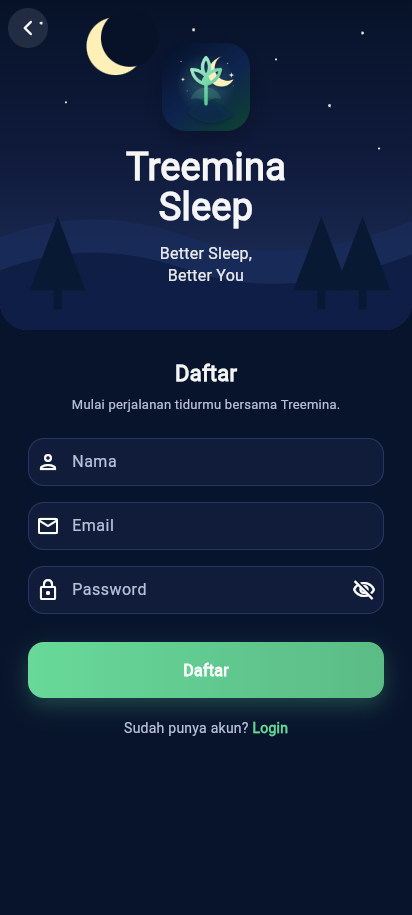
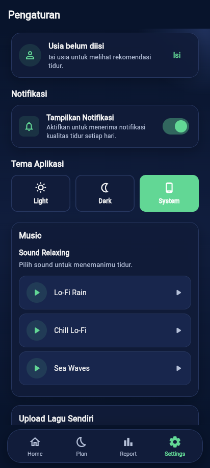

<div align="center">



# Treemina Sleep

**Better Sleep, Better You.**

Aplikasi pendamping tidur untuk mencatat, mengelola, dan memantau kualitas tidur harian —
lengkap dengan perencana jadwal, laporan visual, musik relaksasi, dan sinkronisasi cloud.

[](https://github.com/Adidtiasmara/TreeminaSleep/releases/latest)
[](https://flutter.dev)
[](#)
[](https://supabase.com)

**[Unduh APK versi terbaru](https://github.com/Adidtiasmara/TreeminaSleep/releases/latest)**

</div>

---

## Tentang Treemina Sleep

Tidur yang konsisten adalah fondasi kesehatan fisik dan mental — tetapi kebanyakan orang tidak
tahu seberapa baik mereka sebenarnya tidur. Treemina Sleep hadir untuk menjawab itu dengan cara
yang sederhana: tekan **Start Sleep** sebelum beristirahat, tekan **Wake Up** setelah bangun, dan
aplikasi akan menghitung durasi tidurmu lalu menilai kualitasnya secara otomatis.

Lebih dari sekadar pencatat, Treemina Sleep membantumu membangun rutinitas:

- **Rencanakan** jam tidur dan jam bangun ideal, lengkap dengan hitung mundur menuju waktu tidur.
- **Pantau** pola tidur lewat laporan mingguan dan bulanan yang mudah dibaca.
- **Pahami** kebiasaan tidur lewat kartu insight edukatif yang berganti setiap hari.
- **Tenangkan** diri sebelum tidur dengan musik relaksasi bawaan atau lagu pilihanmu sendiri.

Semua data tersimpan aman di cloud dan mengikuti akunmu — ganti perangkat tanpa kehilangan
riwayat tidur.

## Tangkapan Layar

| Home | Plan | Report |
|:---:|:---:|:---:|
|  |  |  |

| Login | Register | Settings |
|:---:|:---:|:---:|
|  |  |  |

## Fitur Utama

- **Pelacak Sesi Tidur** — mulai dan akhiri sesi tidur dengan timer durasi real-time, lalu
  dapatkan penilaian otomatis: *Excellent Sleep*, *Bad Sleep*, atau *Over Sleep*.
- **Perencana Jadwal Tidur** — atur jam target tidur dan bangun dengan pemilih waktu visual,
  simpan beberapa jadwal favorit, dan lihat hitung mundur menuju waktu tidurmu.
- **Laporan Tidur Visual** — grafik durasi mingguan dan bulanan beserta riwayat lengkap setiap
  sesi tidur.
- **Pengingat & Alarm** — notifikasi pengingat menjelang jam tidur, notifikasi sesi yang
  berjalan, dan pembuatan alarm bangun langsung dari aplikasi (Android).
- **Musik Relaksasi** — pilihan audio bawaan (Lo-Fi Rain, Chill Lo-Fi, Sea Waves) atau unggah
  lagu sendiri ke cloud untuk ditemani tidur.
- **Sinkronisasi Cloud** — autentikasi akun dan penyimpanan per pengguna di Supabase
  (PostgreSQL dengan Row Level Security aktif).
- **Tema Terang, Gelap & Sistem** — antarmuka malam yang tenang dengan transisi halus, atau
  tema terang untuk pemakaian siang hari.

## Teknologi

| Lapisan | Teknologi |
|---|---|
| Framework | Flutter 3.47 / Dart 3 |
| Backend & Database | Supabase (Auth, PostgreSQL, Storage) |
| State Management | Provider |
| Grafik | fl_chart |
| Notifikasi & Alarm | flutter_local_notifications + timezone |
| Audio | audioplayers |
| Penyimpanan Lokal | shared_preferences, hive |

## Mulai Cepat

### Prasyarat

- [Flutter SDK](https://docs.flutter.dev/get-started/install) 3.47+ dengan Dart 3
- Android SDK / Xcode untuk build perangkat
- Akun [Supabase](https://supabase.com) gratis

### Setup Supabase

1. Buat project baru di [supabase.com](https://supabase.com).
2. Jalankan isi [`supabase_schema.sql`](supabase_schema.sql) melalui **SQL Editor** — skema ini
   sudah mengaktifkan Row Level Security pada semua tabel.
3. Aktifkan **Email Auth** pada menu *Authentication → Providers*.
4. Ambil URL project dan *publishable key* dari *Settings → API*.

### Jalankan Aplikasi

```bash
git clone https://github.com/Adidtiasmara/TreeminaSleep.git
cd TreeminaSleep
flutter pub get

# kredensial sudah punya nilai bawaan di lib/services/supabase_service.dart.
# Untuk memakai project Supabase milikmu sendiri:
flutter run \
  --dart-define=SUPABASE_URL=https://<project-ref>.supabase.co \
  --dart-define=SUPABASE_PUBLISHABLE_KEY=<publishable-key>
```

### Build Rilis

```bash
flutter build apk --release
# hasil: build/app/outputs/flutter-apk/app-release.apk
```

## Struktur Proyek

```
lib/
├── main.dart              # titik masuk aplikasi & registrasi provider
├── models/                # model data (user, record tidur, jadwal)
├── pages/                 # halaman UI (splash, auth, home, plan, report, settings)
├── providers/             # state management (sleep, profile, theme)
├── services/              # integrasi (Supabase, notifikasi, alarm, musik, storage)
├── utils/                 # warna, tema, kalkulator tidur
└── widgets/               # komponen UI yang dapat digunakan ulang
```

## Rilis

Unduh binari siap pakai (APK) di halaman
[**Releases**](https://github.com/Adidtiasmara/TreeminaSleep/releases) — rilis saat ini:
**v0.1 beta**. Lihat catatan rilis untuk ringkasan perubahan setiap versi.

---

<div align="center">

Dibuat dengan perhatian oleh [**Adidtiasmara**](https://github.com/Adidtiasmara)

© 2026 Adidtiasmara — Seluruh hak cipta dilindungi.

</div>
